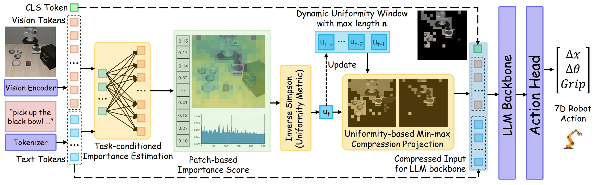
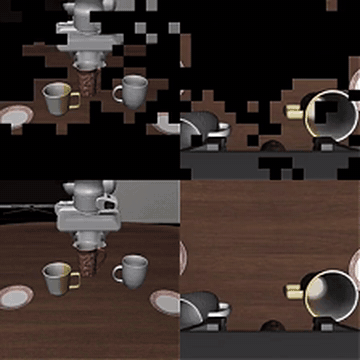
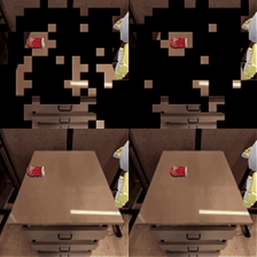
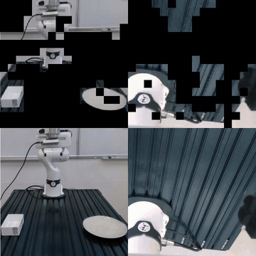
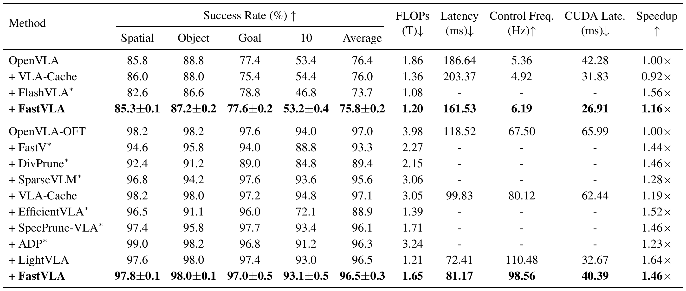
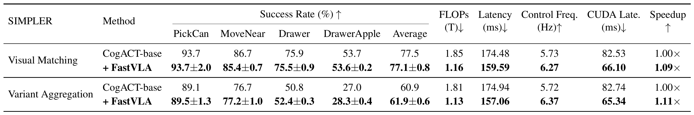
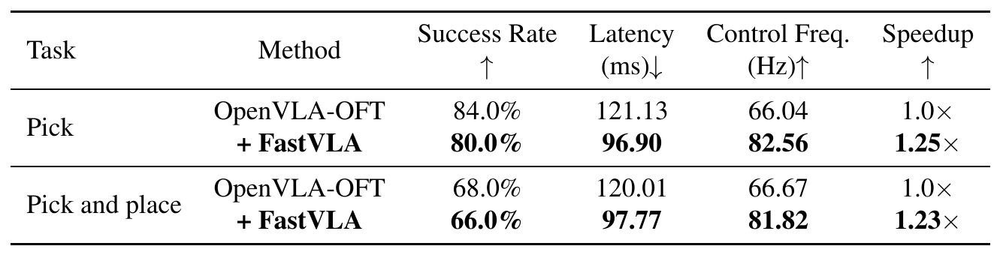
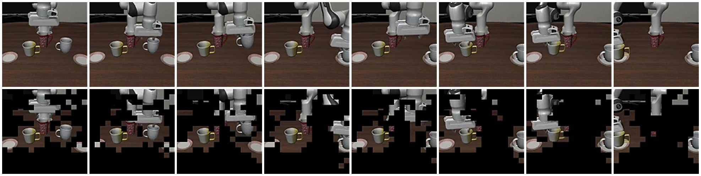
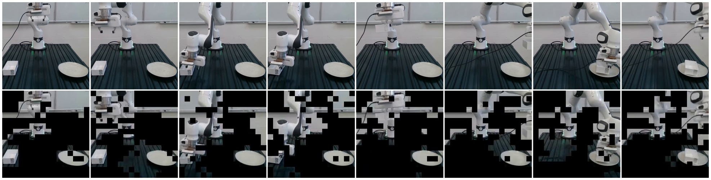

<div align="center">

# FastVLA: Task-Conditioned and Temporally Adaptive Visual Token Compression for Efficient Vision-Language-Action Models

Jiuyi Xu<sup>1</sup>, Chengyuan Qian<sup>2</sup>, Zhengzhong Tu<sup>2</sup>, Yang Sui<sup>3</sup>, Yangming Shi<sup>1</sup>

<sup>1</sup>Colorado School of Mines &nbsp; <sup>2</sup>Texas A&M University &nbsp; <sup>3</sup>Microsoft AI

**WACV 2027**

[](https://arxiv.org/abs/2610.22146)

</div>

<p align="center">
  
</p>

FastVLA is a **training-free, plug-and-play** visual token compression method for Vision-Language-Action (VLA)
models. At every action-prediction step it decides not only *which* visual tokens the policy needs, but also
*how many*: the compression rate adapts from step to step to how concentrated the task-relevant visual evidence is.

## Highlights

- **Training-free and plug-and-play.** No retraining and no caches: FastVLA only decides which visual tokens enter the
  LLM backbone at each step.
- **Task-conditioned.** Visual tokens are scored by task-to-vision attention, i.e. by what the current task needs
  rather than by generic visual saliency.
- **Temporally adaptive.** The number of kept tokens changes from step to step with the concentration of the
  importance distribution (inverse-Simpson uniformity, calibrated online over a sliding window).
- **Faster closed-loop control.** In simulation, FastVLA reduces LLM-backbone FLOPs by 35–59% and action latency by
  9–32% (1.09×–1.46× speedup) at comparable task success; on a real Franka Research 3 robot, it cuts end-to-end latency
  by 20% (1.25× speedup).

## Demo

<table>
  <tr>
    <td align="center" width="33%"><br><b>LIBERO-Long</b> · OpenVLA-OFT</td>
    <td align="center" width="33%"><br><b>SIMPLER</b> · CogACT</td>
    <td align="center" width="33%"><br><b>Franka Research 3</b> · OpenVLA-OFT (2× speed)</td>
  </tr>
</table>

Top row: the visual tokens kept by FastVLA (dropped tokens are shown in black). Bottom row: the original camera images.

## Method

FastVLA runs once per action-prediction step, on the LLM input sequence `[BOS | N visual tokens | task tokens]`:

1. **Importance.** Each visual token is scored by task-to-vision attention: the softmax-normalized scaled dot product
   between RMS-normalized task and visual token embeddings, averaged over the task tokens.
2. **Uniformity.** The inverse-Simpson effective number of the top-K scores, normalized by K, measures how concentrated
   the importance distribution is; K = ⌈(1 − (ρ + τ))N⌉ is the smallest budget the rate band can request.
3. **Adaptive rate.** The uniformity is min–max calibrated against the previous `window` steps and mapped linearly to a
   compression rate in [ρ − τ, ρ + τ]: steps that concentrate on few tokens (relative to the recent past) are pruned more
   aggressively, steps that need broader context more conservatively. The first two steps of an episode use ρ − τ.
4. **Selection.** The most important visual tokens are kept (in their original order and positions); the rest never
   enter the LLM backbone.

There is no training, no cache, and no state across steps besides the `window` most recent uniformity values.

## Results

All results are from the [paper](https://arxiv.org/abs/2610.22146), measured on a single NVIDIA RTX 4090. Control
frequency is the number of actions executed per second (an OpenVLA-OFT call predicts a chunk of 8 actions; OpenVLA and
CogACT predict one action per call). FastVLA success rates are the mean ± standard error over three random seeds.
Methods marked with * could not be reproduced in our setup; their numbers are quoted from the original papers.

### LIBERO

<p align="center">
  
</p>

ρ = 0.8 / 0.7 / 0.75 / 0.6 (Spatial / Object / Goal / 10) on OpenVLA-OFT and 0.35 / 0.5 / 0.4 / 0.3 on OpenVLA;
τ = 0.1 and window = 10.

### SIMPLER

<p align="center">
  
</p>

CogACT-Base; ρ = 0.7 (Pick Coke Can), 0.5 (Move Near) and 0.3 (Open/Close Drawer, Put Apple in Drawer); τ = 0.1 and
window = 10.

### Real robot

<p align="center">
  
</p>

Franka Research 3; OpenVLA-OFT fine-tuned with LoRA on teleoperated demonstrations; 50 rollouts per task and method.

### Visualization

<p align="center">
  <br>
  
</p>

Eight frames sampled uniformly over a LIBERO-Long rollout (top) and a real-world pick-and-place rollout (bottom), from
the third-person camera. Each full observation is shown above the visual tokens kept by FastVLA.

## Code

| File | Description |
|---|---|
| [`fastvla/core.py`](fastvla/core.py) | the method (`FastVLA`), backbone-agnostic, depends only on PyTorch |
| [`prismatic/extern/hf/modeling_prismatic.py`](prismatic/extern/hf/modeling_prismatic.py) | OpenVLA-OFT integration: `PrunedLlamaModel` applies FastVLA before the LLM decoder layers and measures LLM FLOPs / CUDA time |
| [`experiments/robot/libero/run_libero_eval.py`](experiments/robot/libero/run_libero_eval.py) | LIBERO evaluation with `--fastvla_*` options |
| [`vla-scripts/deploy.py`](vla-scripts/deploy.py) | policy server for real-robot deployment with `--fastvla_*` options |
| [`integrations/cogact`](integrations/cogact) | FastVLA for CogACT (SIMPLER) |

## Installation

This repository is built on [OpenVLA-OFT](https://github.com/moojink/openvla-oft) and uses the same environment
(1 GPU with ~16 GB of memory for LIBERO evaluation).

```bash
conda create -n fastvla python=3.10 -y
conda activate fastvla
pip install torch==2.2.0 torchvision==0.17.0 torchaudio==2.2.0  # see https://pytorch.org for your CUDA version

git clone https://github.com/jiuyixu25/FastVLA.git
cd FastVLA
pip install -e .

# LIBERO
git clone https://github.com/Lifelong-Robot-Learning/LIBERO.git
pip install -e LIBERO
pip install -r experiments/robot/libero/libero_requirements.txt
pip install bddl==1.0.1 mujoco==2.3.2 gym==0.25.2 robosuite==1.4.1
```

The last line pins the simulator packages to the versions we used: newer `bddl` / `mujoco` / `gym` releases change the
outcome of some LIBERO tasks, for the baseline as well. If `tensorflow` complains about `numpy`, run
`pip install numpy==1.26.4 opencv-python==4.10.0.84`. If `import libero` fails, add the LIBERO repository to
`PYTHONPATH`.

## Evaluation on LIBERO (OpenVLA-OFT)

```bash
python experiments/robot/libero/run_libero_eval.py \
  --pretrained_checkpoint moojink/openvla-7b-oft-finetuned-libero-spatial \
  --task_suite_name libero_spatial \
  --fastvla_rho 0.8 --fastvla_tau 0.1 --fastvla_window 10
```

Add `--fastvla_enable False` to evaluate the uncompressed policy. To run all four suites with the hyperparameters
from the paper:

```bash
bash scripts/eval_libero_fastvla.sh
```

Besides the success rate, the evaluation reports the average action-prediction latency, the control frequency
(actions executed per second), the average LLM-backbone TFLOPs and CUDA latency per forward pass, and the average number
of visual tokens kept. Results are written to `experiments/logs/` (a `.txt` log and a `.json` summary per run).

## Hyperparameters

FastVLA has three hyperparameters: the target compression rate ρ, the allowed per-step deviation τ, and the length of
the calibration window. The paper uses τ = 0.1 and window = 10 throughout, and the following ρ:

| Backbone | Benchmark | ρ per suite / task |
|---|---|---|
| OpenVLA-OFT | LIBERO | Spatial 0.80 · Object 0.70 · Goal 0.75 · Long (LIBERO-10) 0.60 |
| CogACT-Base | SIMPLER | Pick Coke Can 0.70 · Move Near 0.50 · Open/Close Drawer 0.30 · Put Apple in Drawer 0.30 |

## CogACT (SIMPLER)

Set up CogACT's [SIMPLER evaluation](https://github.com/microsoft/CogACT#evaluation-in-simpler). Then, in
`SimplerEnv/simpler_env/main_inference.py`, right after the `CogACTInference` model is created, add

```python
from fastvla_cogact import install_fastvla
install_fastvla(model)
```

and run CogACT's SIMPLER scripts with `integrations/cogact` on `PYTHONPATH`, setting ρ per task, e.g.

```bash
PYTHONPATH=/path/to/FastVLA/integrations/cogact:$PYTHONPATH FASTVLA_RHO=0.7 \
  bash simpler_env/policies/sim_cogact/scripts/cogact_pick_coke_can_visual_matching.sh
```

(`FASTVLA_TAU` and `FASTVLA_WINDOW` default to 0.1 and 10.)

## Real-robot deployment

`vla-scripts/deploy.py` serves an OpenVLA-OFT policy with FastVLA over HTTP (see OpenVLA-OFT's
[ALOHA.md](ALOHA.md) for the client side):

```bash
python vla-scripts/deploy.py \
  --pretrained_checkpoint /path/to/your/openvla-oft/checkpoint --unnorm_key your_dataset \
  --num_images_in_input 2 --use_proprio True \
  --fastvla_rho 0.8 --fastvla_tau 0.1 --fastvla_window 10
```

Add `"reset": true` to the first request of every episode to clear FastVLA's calibration window.

## Using FastVLA in your own VLA

`FastVLA` works on any LLM input laid out as `[BOS | N visual tokens | task tokens]`:

```python
from fastvla import FastVLA

pruner = FastVLA(hidden_size=4096, num_patches=512, rho=0.8, tau=0.1, window=10)

pruner.reset()  # at the start of every episode
# once per action-prediction step, before the LLM decoder layers:
embeddings, position_ids, attention_mask = pruner(embeddings, position_ids, attention_mask)
```

Kept tokens keep their original position ids. For other layouts, `pruner.select(visual_tokens, task_tokens)` returns
the boolean keep mask of one step.

## Tests

```bash
python tests/test_fastvla.py
```

runs CPU checks of the pruner (rate band, warm-up, fixed-rate case, sequence bookkeeping) and of `PrunedLlamaModel`.

## Citation

If you find FastVLA useful in your research, please cite:

```bibtex
@article{xu2026fastvla,
  title   = {FastVLA: Task-Conditioned and Temporally Adaptive Visual Token Compression for Efficient Vision-Language-Action Models},
  author  = {Xu, Jiuyi and Qian, Chengyuan and Tu, Zhengzhong and Sui, Yang and Shi, Yangming},
  journal = {arXiv preprint arXiv:2610.22146},
  year    = {2026}
}
```

## Acknowledgements

This code is built on [OpenVLA-OFT](https://github.com/moojink/openvla-oft). The integration of the pruner into the
LLM backbone (`PrunedLlamaModel`) is adapted from [LightVLA](https://github.com/LiAutoAD/LightVLA); we also thank the
authors of [VLA-Cache](https://github.com/siyuhsu/vla-cache). FastVLA is evaluated with
[OpenVLA](https://github.com/openvla/openvla), [OpenVLA-OFT](https://openvla-oft.github.io/),
[CogACT](https://github.com/microsoft/CogACT), [LIBERO](https://github.com/Lifelong-Robot-Learning/LIBERO) and
[SIMPLER](https://github.com/simpler-env/SimplerEnv).

If you run into problems, please open a GitHub issue. If you do not receive a response within 2 business days, please
email Jiuyi Xu (jiuyi_xu@mines.edu).

## License

MIT, see [LICENSE](LICENSE). This repository contains code adapted from LightVLA (MIT, see
[LICENSE_LightVLA](LICENSE_LightVLA)).
